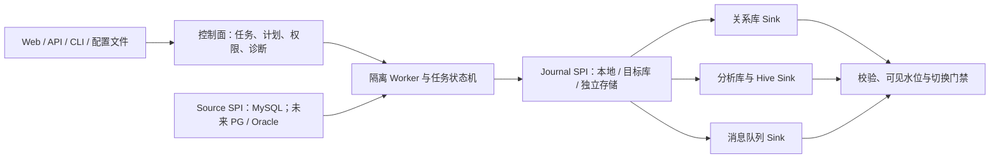

# Rivomesh 完整产品与技术方案

更新日期：2026-11-15。English: [Platform design](/reference/en/platform-design.html)。决策状态见[需求记录](/reference/zh-CN/requirements-and-decisions.html)。

**本文是完整需求与设计，不是全部功能完成声明。** V3 已支持每任务一个逻辑 MySQL 源下的多 database 显式映射、同源多目标、多配置独立 Worker、可选持久日志及 Web 管理。v2 单 database/单目标仍保留兼容。各适配器的实际验收范围以[实施状态](/reference/zh-CN/implementation-status.html)和[验证记录](/reference/validation.html)为准，操作见[控制台手册](/reference/zh-CN/console-and-deployment.html)；其余能力按下文继续实施。

## 1. 产品定位与范围

Rivomesh 面向政企的数据库迁移、持续同步、数据分发、迁移验证及切换编排。提供中英文 Web 工作台，普通安装通过向导完成，专家可以使用同一模型的配置文件/API/CLI。

| 维度 | 范围 |
|---|---|
| 本期源 | MySQL，至少覆盖已有 8.0/8.4；单机、GTID 主从和单主 MGR |
| 未来源 | PostgreSQL、Oracle；本期先设计 Source SPI 和中立断点/事件模型，不宣称连接器已支持 |
| 关系型目标 | MySQL、PostgreSQL、openGauss、分布式 GaussDB、达梦、金仓、OceanBase、GBase；按产品/版本/兼容模式/引擎建档 |
| 分析/数仓目标 | ClickHouse、Apache Doris、Apache Hive；GBase 各分析/事务产品按实际能力分类 |
| 本期消息目标 | Kafka、Pulsar、RabbitMQ、RocketMQ、ActiveMQ（Classic/Artemis 独立档案）、Redis Streams、NATS JetStream |
| 部署 | Linux 手动、Docker、Kubernetes Helm、Kubernetes 原生配置清单 |
| 存储 | 本地持久日志、复用合适目标库、独立共享日志，三种模式可选择 |

“尽量支持所有版本”意味着持续扩展的兼容矩阵及能力探测，不代表无条件保证所有历史版本、厂商分支和组合。每个功能标记已验证/实验/未验证/不支持，测试注明实际产品、版本、模式、驱动、硬件和恢复边界。JDBC 能连接不是验收标准。

## 2. 多任务与多目标

每份独立配置定义一个逻辑源、选表范围、多个目标、映射、存储和资源策略；不同配置可以绑定不同独立 MySQL 集群。支持单任务独立进程，也支持一个控制台管理多个隔离 worker。不会隐式把不同源合成一个事务或一张目标表。

任务、订阅、表、目标、配置版本与流世代有独立标识。源候选地址属于同一拓扑；多库逐库显式映射。启动检查目标重叠写入、数据库自身回环、源身份变更和配置指纹，新增目标单独建立基线。每任务限流、线程/连接/内存/磁盘配额，避免一个故障任务影响整个平台。

不同配置默认分别采集。后续可以显式共享同源采集，但必须核对权限、过滤、日志保留、源身份和恢复依赖，不能仅凭 host 相同就合并。跨库事务只有落到同一个支持原子提交的目标范围内才保留完整原子性；跨目标不做全局 XA。

## 3. 模块划分与核心契约

- Source SPI：发现能力/对象、建立一致基线、采集事务/DDL、编码/恢复源位置、校验切主、上游确认；不能把所有源都抽象成 GTID。
- Journal SPI：完整事务/大事务分片的持久化、原子发布、校验和、恢复、配额与回收；只有事务完整持久化后才推进安全采集位置。
- Sink SPI：能力与对象规划、写入/发布、查询不确定提交、幂等/版本、DDL 恢复和可见水位。区分事务写入、版本物化、批次发布、消息发布等能力，避免所有方法都假设 JDBC 事务。
- Control/Worker：租约及 fencing、任务隔离、版本化配置、资源调度、可恢复操作日志；控制台离线不应使已部署 worker 丢断点。
- Validation/Cutover：基线/屏障、数据差异、约束恢复、写入归属及操作审计。

事件信封包含逻辑 sourceId、streamGeneration、事务标识、事务内序号、schemaVersion、表标识、操作、before/after、字段存在位图、快照/DDL/事务边界、源位置和 origin。事件 ID 在重试、源物理主库切换时保持稳定；新基线/新源血缘使用新世代。时间戳只用于观察，不用于决定事务顺序。

源位置采用带版本的类型化载荷：MySQL GTID/恢复依赖，PostgreSQL LSN/slot/数据库与实例血缘，Oracle SCN/事务/redo 上下文等由适配器解释。统一层不通过比较字符串决定先后，不能只保存“最大已见 SCN/LSN”而丢弃长事务或未提交片段。快照片段也需要稳定 ID、完整性标记和断点。

PostgreSQL 适配器后续需处理导出快照、slot/WAL 保留、REPLICA IDENTITY、未变化 TOAST 值和切主后 slot 就绪；Oracle 需处理补充日志、redo/归档、长事务、RAC/CDB/PDB、LOB 及源血缘。官方资料说明 PG slot 切换有同步就绪前提，Oracle CDC 的补充日志也是明确条件。[PostgreSQL](https://www.postgresql.org/docs/current/logical-replication-failover.html)、[Oracle CDC 参考](https://debezium.io/documentation/reference/stable/connectors/oracle.html)。驱动和采集方式分别审查分发许可；不把未来连接器当作当前已支持的回切通道。

## 4. 目标能力与一致性

| 目标类 | 写入设计 | 界面必须说明的边界 |
|---|---|---|
| MySQL/PG/国产事务库 | 方言化批量 INSERT/UPDATE/DELETE 或原生 upsert；业务与本地应用断点同事务 | 单目标支持范围内的源事务原子性；不要因公共控制库独立而丢掉本地断点 |
| ClickHouse | 稳定行物化键、单调版本和删除标记；按引擎选择替换物化/读视图 | ReplacingMergeTree 后台合并不保证裸表随时去重；采用经验证的 FINAL/视图查询契约，不能承诺跨表事务 |
| Doris | 经验证的 Unique Key/Merge-on-Write、顺序列、删除与 Stream Load 批次协议 | 探测单/多表提交范围，保存 label/txn 状态并处理超时和保留窗口，不把所有版本视为相同 |
| Hive | ACID 表能力模式或不可变文件/分区/快照发布模式 | 普通 Hive 表不能伪装成逐行数据库；更新/删除、可见延迟、事务与 compaction 按模式建档 |
| 消息目标 | 带稳定事件 ID 的变更事件和事务/快照边界发布 | 发布确认不代表下游业务处理完成；默认至少一次，消费方需幂等 |

ClickHouse 的替换依据 ORDER BY，不能把可变化属性或不稳定分区设计当作行身份；同一逻辑行需要稳定路由，旧版本/删除标记清理必须与最早可能重放位置协调。[官方引擎说明](https://clickhouse.com/docs/guides/replacing-merge-tree)。

Doris 的 Unique Key 是行物化模型，不等同于源端可降级的业务次级 UNIQUE，不能机械改成 Duplicate Key。批次确认丢失需查询真实提交状态；过期 label 不能当作无限期去重凭证。[顺序列](https://doris.apache.org/docs/4.x/data-operate/update/unique-update-concurrent-control/)、[导入事务](https://doris.apache.org/docs/dev/key-features/load-transaction.html/)。这些资料不构成对所有旧版本的承诺。

Hive 文件发布必须记录批次、文件清单/摘要、分区、schema 和元数据提交状态；临时文件不能被消费者提前读取，对象存储不能假设原子 rename。失败恢复需对账文件及 catalog，防重复、半批次和孤儿文件；ACID 模式则使用经验证的事务 API/配置及 compaction 规则。[Hive Transactions](https://hive.apache.org/docs/latest/user/hive-transactions/)。分析目标默认作为数据服务/数仓输出，不能未经适用性检查就列为 OLTP 应用接管目标。

统一展示 captured（已持久采集）、delivered（目标已接收）、applied/materialized（变更已应用）、visible（按读取契约可见）、validated（在声明屏障校验通过），按适配器实际能力提供。不能用一个“成功”状态覆盖所有差异。

## 5. 无主键、JSON 和生成列

三类均是首版需求，需要开发；当前程序仍明确拒绝。不是通过删除校验即可支持。

| 行身份类别 | 计划策略 |
|---|---|
| 有主键 | 稳定主键扫描和行定位，处理主键变更 |
| 无主键但有全列 NOT NULL 的可靠唯一候选键 | 经语义校验选作定位键，处理键变更；这类身份约束不随次级 UNIQUE 随意降级 |
| 真正无唯一键，允许完全相同重复行 | 一致基线 + 多重集语义 + 持久化技术行身份/计数 + 精确 before-image 匹配；每条日志只更新/删除一个对应行出现次数 |

真无键表不能用“目标加个自增 ID”“整行 hash 当唯一键”或 OFFSET 在线续扫替代正确性。hash 只作候选加速，必须核对完整类型化值并保留重复次数，不能用一个 DELETE 条件删掉所有重复行。技术身份改变物理结构时，提供显式列映射/兼容视图及依赖检查，不能声称 SELECT * 完全不受影响。

真无键全量需可重放的一致快照产物，并与源日志基线协调。先持久化快照片段/清单，再导入并回放基线后的事务；重复导入按片段与事务 ID 去重。源 MVCC 快照若随连接退出而永久丢失，不能仅凭行号恢复旧快照：需恢复已完成产物，或在可证明的新基线重建该表，不重置其他已完成订阅。源切主发生在未完成无键快照时同理。向导说明一致性协调所需权限、可能的短时锁/重扫和磁盘成本，不能承诺任意无键表零锁且精确行游标续传。[MySQL 行查找机制](https://dev.mysql.com/doc/refman/8.4/en/replication-features-row-searches.html) 可作设计参考，不代表复用其内部存储实现。

JSON：正确解析 MySQL binary JSON，精确保留数值、SQL NULL 与 JSON null、数组顺序及字符；按能力映射原生 JSON 或文本/LOB，报告查询能力差异。对账用声明的语义规范，不能拿对象键顺序/空白不同当成数据丢失。首版要求完整 JSON 日志；现有空的 binlog_row_value_options 要求继续保留，除非专门实现部分 JSON patch 及历史基线恢复。[MySQL JSON 复制](https://dev.mysql.com/doc/refman/8.4/en/replication-features-json.html)。

生成列：区分 STORED/VIRTUAL、源日志实际提供的列和值、表达式依赖和 schema 版本。选择经验证等价的目标生成表达式，或普通列物化；日志缺值时需要正确的历史输入求值，不能事后查询源“当前行”补值。表达式翻译/求值需覆盖 SQL mode、字符比较、时区、精度和 JSON 函数，未覆盖表达式给出精确阻断与替代计划，不静默置 NULL。目标仍是生成列时不能向其直接 INSERT 生成值。普通列物化与原生生成列的接管语义差异也需写入恢复计划。[MySQL 生成列](https://dev.mysql.com/doc/refman/8.4/en/create-table-generated-columns.html)。

## 6. DDL、既有目标和约束

发现并版本化表定义、索引、生成表达式和依赖。DDL 是有序日志事件，需要 schema 屏障和可恢复操作日志；按操作/目标能力给出自动转换、计划迁移或阻止执行，不能把所有 DDL 当任意 SQL 直接转发。非事务 DDL、重启和提交不确定必须通过目录对账恢复。

既有目标支持路线：兼容空表直接导入；非空表选择独立 staging/shadow 后比对发布、可靠唯一键下的明确合并规则，或已有一致数据+可证明日志位置的增量接入。没有可验证基线就不做“只填一个 GTID 直接接续”。无键非空合并需要多重集规则，不能靠 upsert 猜测；目标额外行、冲突行、触发器/外键副作用均先出差异计划，不自动清空。

Gauss 业务次级 UNIQUE 转普通索引；其他目标约束不兼容时允许按产品规划降级并保存原定义。不能降级主键/候选定位键、内部去重结构和分析引擎必需的行物化键。没有等价索引时报告能力缺失，不能凭空建一个“普通索引”。GSI 替代、索引恢复与接管约束详见[索引策略](/reference/zh-CN/gaussdb-index-policy.html)。

## 7. 三种可选日志部署

| 模式 | 建议用途 | 可用性与恢复限制 |
|---|---|---|
| LOCAL | 无额外服务的单机/Docker；持久目录/PVC | 支持进程重启；跨节点接管必须重新访问原日志、核对权威 owner 并隔离旧节点，否则不启用自动 HA |
| TARGET | 复用已验证事务库的管理 schema | 无新增独立存储，但该目标不可用可能阻塞采集；只有 ClickHouse/Hive/MQ 时不能默认选择此模式 |
| EXTERNAL | 独立 HA 日志/状态适配器，多个 worker 接管 | 可提高故障隔离；后端、确认和回收规则需单独验收，不把任意共享目录/对象存储视为天然安全日志 |

持久化确认、校验和、完整事务标记、流序号及 owner 必须成体系。大事务可先落盘分片，但不得把半事务标记采集完成；关系目标也不能为省内存而拆开提交本应原子的源事务。配置超限要可诊断地阻断或使用明确能力模式，不能 OOM 后失去来源。

日志按最慢有效订阅及活跃基线依赖回收；配额将满告警、背压、显示可坚持时长。人工放弃某目标恢复历史必须是显式“重新全量”计划，而不是静默跳过。消息队列作为目标与作为内部日志是两种角色；接入某 MQ 目标不自动意味着已实现其 Journal 后端。

## 8. 七类消息目标

| 目标 | 适配重点 |
|---|---|
| Kafka | 分区键、可靠确认、producer 幂等与事务能力、事务 ID fencing、schema/压缩；跨重启/外部断点仍需恢复协议 |
| Pulsar | 分区/路由、稳定 producer 身份和 sequence、持久 topic、去重窗口/事务配置 |
| RabbitMQ | durable 队列/消息、publisher confirms、mandatory/return、重连后不确定发送重试、队列绑定 |
| RocketMQ | 普通/顺序消息和版本能力、路由 key、确认与重试；事务消息不自动绑定源数据库日志提交 |
| ActiveMQ Classic / Artemis | 分开驱动/协议档案，持久消息、session/发送确认、事务和重连；Artemis 去重不代表 Classic 同能力 |
| Redis Streams | XADD、持久化/复制策略、stream/consumer-group 与保留配置；自动 stream ID 不代替业务 eventId |
| NATS JetStream | durable stream、发布确认、subject/consumer、去重 ID/窗口和存储配额；不是易失 Core NATS 模式 |

共同契约是至少一次发布和稳定 eventId，消费者按 eventId/行版本幂等。支持 JSON 首选信封，预留 Avro/Protobuf 及 schema registry；注册中心不是基础部署必选项。类型信息不得丢失，DDL/schema 变化需版本通知。

需要选择按表/主键有序或整事务单分区模式；分区、队列重投递和消费者并发不能承诺天然全局顺序。大事务/大消息分片要携带事务 ID、分片序号、总量/结束标记及校验和，消费者完整组装后才可原子应用。不同路由的事务边界记录需声明过滤范围，不能让消费者等待永远不会发送的行。

Kafka/Pulsar 的 broker 事务、去重窗口或幂等 producer，不自动产生“源库→broker→任意消费者业务库”的端到端 exactly-once。RabbitMQ 官方明确指出，确认丢失后的重发可能重复。[RabbitMQ 可靠性](https://www.rabbitmq.com/docs/reliability)。其他协议同样需要不确定提交恢复验收。

Redis Streams 与 JetStream 分别具有自己的保留、ACK、持久化及去重配置；需检测有效策略，不能以启用 API 等同于持久交付。[Redis Streams](https://redis.io/docs/latest/develop/data-types/streams/)、[JetStream](https://docs.nats.io/concepts/jetstream)。ActiveMQ 的两类适配按其文档分别验证：[Classic 事务](https://activemq.apache.org/components/classic/documentation/should-i-use-transactions)、[Artemis 去重](https://artemis.apache.org/components/artemis/documentation/latest/duplicate-detection.html)。

默认不跳过坏消息。目标路由不存在、消息超限或序列化失败要暂停并给出 UI 修复路径；若产品以后提供“隔离并继续”，必须保存可重放事件并明确标记事务完整性/一致性下降。broker 接收确认之后，其保留和消费者处理属于另一监控层，不能用发布水位声称所有订阅都已处理。

## 9. 故障模型

至少覆盖源切主/复制 IO/SQL 错误、多写主隔离、进程/节点退出、目标网络中断与 SQL 错误、未知提交结果、存储满/损坏、DDL 中断、MQ ACK 丢失、消息重复/乱序、分析批次半完成、配置升级和备份回退。

瞬时错误退避重试，确定性问题暂停受影响订阅；重启和切备用不能绕过暂停。UI 提供原因、影响目标/表、最近安全位置、积压与推荐处理步骤，修复后重试原失败单元。默认不提供编辑 GTID/LSN/SCN 或跳过事务的快捷按钮。物理源 HA 系统负责提升和旧主隔离；已永久丢失的源数据无法重建。

## 10. 图形工作台与操作流程

向导：选择场景 → 添加源/目标并测试 → 扫描对象与权限 → 显示兼容/约束/存储/容量方案 → 显式映射 → 预览执行计划 → 启动 → 观察/处理问题 → 屏障校验 → 切换/交付。

页面包含总览、连接与驱动、任务/订阅、对象差异、日志与容量、索引/DDL、数据校验、故障中心、切换计划、部署诊断和操作审计。普通用户看到可理解的原因与下一步，专家可展开 SQLState、厂商错误码和脱敏诊断；错误码稳定，中英文解释一致。

暂停/恢复、重试、变更映射、调并发、修复对象、重建单表、验证和计划切换通过有权限的 API 执行，并有请求 ID、期望配置版本、幂等处理、后台任务状态和审计；不直接让浏览器改元数据表。破坏性动作展示影响对象及恢复点，不默认为用户删数据。CLI/文件模式走同一服务契约，支持无人值守及离线环境。

角色区分查看、运维、迁移管理和凭据管理；密码不写日志或普通导出。提供离线帮助、任务诊断包、指标/告警接口；不将遥测上传作为运行条件。界面“恢复”不能代替厂商数据库管理员修复源复制错误。

## 11. Linux、Docker 与 Kubernetes

Linux 交付发行包、示例配置、启动/状态/停止/升级说明及 systemd 服务；Docker 交付可版本锁定镜像、健康检查、持久卷和凭据注入示例；验证 x86_64/ARM64、JDK/驱动和系统依赖后按矩阵声明支持，不把 Java 字节码可移植当作全部原生库可移植。

Kubernetes 必须同时交付 Helm Chart（values/schema、模板、升级、持久化选项）和原生 YAML（ConfigMap、Secret 引用、Service、工作负载、探针、RBAC、PVC 等适用对象），支持 kubectl apply。两套清单由同一配置模型维护并做渲染/一致性检查；测试默认/本地卷/外部存储/HA 和升级组合，不能只提供一份 Helm 截图或要求用户手写资源。

权威日志在本地时使用可恢复卷和单写者策略；共享日志模式可以使用无本地权威状态的 worker。副本数不等于安全接管，RWO 本身也不代替 fencing。配置/Secret 更新先校验，再以版本化方式生效；停止时完成或回滚当前安全单元并释放租约。liveness 看进程可恢复性，readiness/业务状态单独表达源离线和订阅暂停，避免故障重启风暴。

生产交付支持内网镜像仓库、离线驱动包/依赖及证书配置。国密、指定系统/CPU 和厂商兼容认证按真实依赖与测试单独列项，不宣称工具默认取得任何认证。

## 12. 硬件—性能标准

交付基准工具、工作负载定义、原始报告及容量向导，不在缺少实测时发布“几核一定多少万行”的数字。可用 4C/8GiB、8C/16GiB、16C/32GiB 作为**实验档位**，不是已测吞吐或最低生产配置；源、worker、日志和每个目标的硬件分别记录。

报告至少包含 CPU 型号/架构/配额、内存/堆、磁盘类型/容量/实测带宽及 IOPS/持久化设置、网络 RTT/带宽、产品/驱动版本、表/索引、行宽、JSON/LOB、键类型、事务大小、增删改比例、目标数、批次/并发及确认策略。

指标分别测全量 rows/s 和 MiB/s、增量 events/s/transactions/s、端到端 p50/p95/p99 延迟、可见延迟、积压增长、故障接管/追平时间、CPU/内存/磁盘、源业务影响及最终校验。对无键、多目标、MQ、不同 JSON/事务大小分别测试；不可把单表窄行测试外推到所有场景。

容量估算：若积压 B 与稳定流入速率 r、应用能力 c 使用同一单位，只有 c&gt;r 时可持续追平，理想追平时间约 B/(c-r)。日志空间约为“实际持久化日志速率 × 所需保留时长 + 活跃快照产物 + 大事务临时空间 + 索引/元数据与安全余量”，再按实测压缩/写放大修正。硬件增加不能消除单热键、顺序约束、源/目标瓶颈或网络限制。

## 13. 迁移、并行服务和扩展方向

| 场景 | 设计边界与扩展 |
|---|---|
| 在线迁移/只读镜像 | 全量+CDC、数据/对象对账、业务次级约束转换和迁移报告 |
| 新旧环境同时读服务 | 单一权威写源，读流量按表/目标水位决定是否可切，明确陈旧读预算 |
| 灰度/分业务域切换 | 明确表/业务域的唯一写入归属、应用路由和跨域事务边界；同步服务不自行改应用入口 |
| 双方独立写同一表 | 另需双向采集、冲突规则、origin/防回环、键分配和数据修复；不是两条单向任务相互连上即可 |
| 切换后回退 | 新库尚未写业务数据时可按计划回退；已经写入后必须有已验证反向捕获/补偿和重新校验，不能只改连接串 |
| 实时数仓/事件分发 | ClickHouse/Doris/Hive 和七类 MQ；保留可追踪事件与 schema 契约 |
| 应用兼容评估 | SQL/对象差异、只读影子查询、关键接口回归和性能报告；数据迁移不保证应用 SQL 自动兼容 |

正式切换流程包含冻结相关源写/DDL、最终屏障、各目标应用/可见位置、差异校验、必要约束/生成逻辑恢复、同步写隔离和应用路由交接。只有全部门禁通过才开放新写入，不承诺自动更改用户应用或无条件零停机。

后续可扩展审计溯源、历史版本/CDC 归档、数据质量规则、脱敏分发、迁移演练和容量预测；任意转换/脱敏都要标记该目标不再是原样镜像。PostgreSQL/Oracle 采集应优先作为后续插件里程碑，之后才能验证对应环境回切。双向写、任意冲突自动合并和跨环境全局事务单列高级项目，不能隐含进首版承诺。

## 14. 实施顺序与完成标准

| 阶段 | 交付与验收 |
|---|---|
| P0 基础 | Rivomesh 更名、源中立事件/断点和 SPI、能力矩阵、配置版本、任务/订阅隔离；保持已有恢复回归 |
| P1 正确性与界面骨架 | 无键/JSON/生成列、基线与 DDL 恢复、关系目标、向导/故障页；对象/事务/故障矩阵验证 |
| P2 存储与分发 | 三种日志模式、多目标、全部本期 MQ、ClickHouse/Doris/Hive；ACK 丢失/重复/乱序/半批次/配额验证 |
| P3 迁移闭环 | 非空目标计划、校验/修复、约束恢复、切换门禁、审计、Linux/Docker/Helm/原生 YAML、完整双语手册 |
| P4 性能与产品验收 | 硬件基准、长稳/故障/升级矩阵、安全配置与离线交付测试；对每个目标如实列出验证状态 |
| 后续源里程碑 | PostgreSQL、Oracle 连接器及各自快照/长事务/切主验收，再讨论可验证的反向链路 |

分阶段实施不把已列入本期的 MQ 或对象改成可选建议。每个阶段提供可运行功能、对应界面、双语文档与故障测试；文档/界面不得把仅有设计的适配器标成可用。Apache 准备另包括名称审查、社区治理、版权/依赖许可、LICENSE/NOTICE、可复现构建和测试基础设施；Rivomesh 当前不是 Apache 项目。[ASF 命名流程](https://www.apache.org/foundation/marks/naming.html)。
