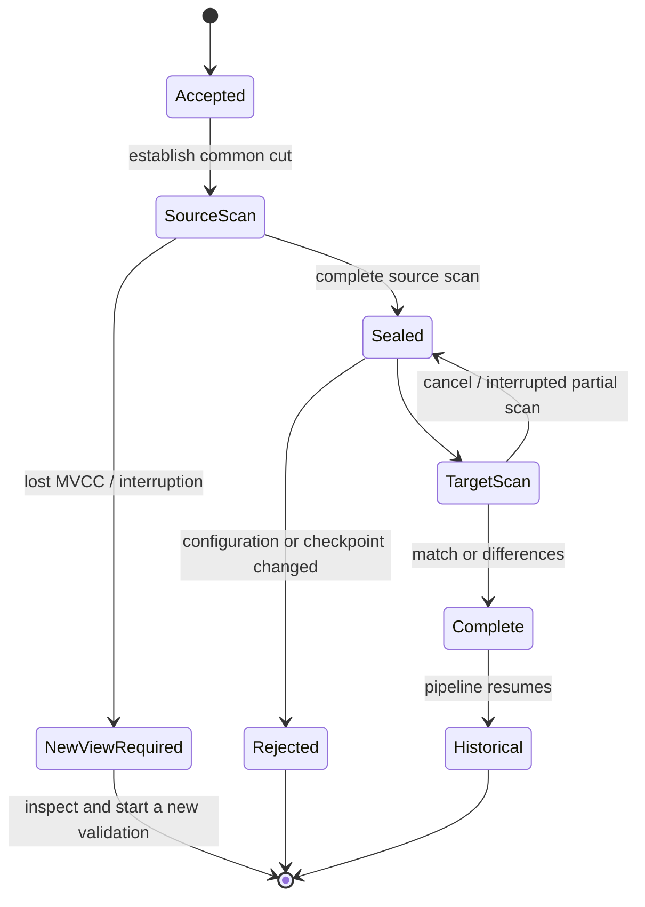

# Managed data validation

Use the validation workflow to select SQL destinations, set time and storage budgets, run or cancel background checks, retry destination comparisons against a sealed source, and review per-table results. To correct differences reported at a common cut, use [managed repair](/docs/en/reference/managed-repair.html). To review a stalled MySQL source transaction, see [capture recovery](/docs/en/reference/capture-recovery.html).

## Use the console

1. Complete V3 snapshots, run the local Worker and verify shared RUNNING state. Selected destinations must be able to reach the common cut; unselected destinations can be paused/offline.
2. As ADMIN, select transactional SQL destinations under Data validation. Messaging/analytical destinations are excluded. First native row profiles cover MySQL/PostgreSQL; other SQL product versions/modes require separate acceptance.
3. Set source-gate, source-read and per-target-table deadlines plus logical/per-row budgets. Gate maximum is120seconds, reads24hours, rows32MiB. Total logical budget must be at least four times the row budget and includes source, destination and keyless identity records. Physical storage is additional.
4. Start comparison. After checking the current configuration revision, scope, report ID and budgets are persisted before execution in a separate background queue. Establishing the cut briefly blocks MySQL instance writes; business writes can continue after gate release while replication retains its durable pause.
5. Follow operation history, then open the report. Results show source/target counts and missing/extra/changed rows per table,50table results per page. A historical result does not establish current equality.
6. Inspect results/shared state and explicitly resume using the current error version. Validation never clears/repairs business tables, rebuilds UNIQUE or transfers write ownership.

## Cancel and recover

Cancel is a durable request, not resume. Owned read connections/locks are aborted and complete sealed source data is retained. The response does not guarantee release at an exact millisecond:driver/connect/network timeouts also matter. Observe task state and database sessions.

Cancellation before establishing a barrier can leave shared RUNNING state; the controller stops its local Worker and displays actual shared state. Once a barrier is established, cancellation never bypasses PAUSED.

A sealed source allows Retry target comparison after loading the report. Original configuration/positions/epoch/physical target checkpoints and source integrity are checked; partial destination scans are discarded and reread, even with the source offline. The report's staging budget is retained; retries default to ten minutes per target table. Existing-report quota expansion and richer retry planning remain pending.

An incomplete source MVCC view cannot survive process loss. Keep the failed report, inspect/explicitly resume as appropriate, and establish a new cut. Never mix source views or rewrite report hashes/GTIDs. Controller restart can reuse a report ID when complete source data survived but the operation completion did not; without a complete source view/local Worker, it fails explicitly rather than resuming the shared pipeline. One validation runs at a time; ordinary controls use a separate pool.

## Access, audit and storage

ADMIN starts/cancels/retries; OPERATOR/VIEWER read summaries only for granted tasks. Cross-task access is hidden. Mutations require current revision and request ID; replay does not create another job. Previously accepted asynchronous work can continue after authorization changes; subsequent requests use current grants.

Audit records actor, task, report ID, request hash and acceptance/completion/cancellation/read events. Corresponding audit writes are required before the HTTP response. Raw business values are excluded from summaries/history.

Reports live under `platform.dataDirectory/validations/<taskId>/<reportId>`. The H2 files contain unencrypted row values. Put them on a protected persistent volume and include them in coordinated backups. The console keeps approximately 40 recent operations per task. Reports can still be opened by ID or browsed in the historical directory. A restarted Agent must have access to the original report directory.

## API

POST `/api/tasks/<taskId>/actions` with `X-Request-ID` and current `expectedRevision`:

```json
{"action":"VALIDATE","expectedRevision":"<revision>","validation":{"targets":["postgres"],"gateMillis":30000,"sourceMillis":3600000,"targetMillis":600000,"limits":{"maximumBytes":1073741824,"maximumRows":1000000000,"maximumRowBytes":4194304}}}
```

Retry uses `VALIDATE_RETRY` and `validation:{"reportId":"<UUID>","targetMillis":600000}`. Cancel uses `VALIDATE_CANCEL` without validation input. GET `/api/tasks/<taskId>/validations/<reportId>` reads a summary. `VALIDATION_REPORT_NOT_CREATED` means inspect the operation failure; `VALIDATION_REPORT_BUSY` means retry after the active scan.

[Core contract and FAQ](/docs/en/reference/reconciliation-workflow.html) / [中文](/docs/zh/reference/managed-validation.html)


## Job recovery paths




First native managed acceptance passed LOCAL/H2 and external PostgreSQL/MySQL/openGauss journals with MySQL8.4/PostgreSQL17 destinations, including cancellation during an actual relation-lock wait, sealed-source retry and report/audit persistence across controller restart. See [evidence and failure corrections](/docs/en/start/verification.html).


## Administrator difference details

For a completed report, ADMIN can open differences per target/table, page by identity hash, then explicitly reveal raw values. Stored source column names/types accompany expected/actual cells. An absent row is distinct from a present SQL NULL cell. Keyless source/target occurrence IDs are displayed without generating replacements.

POST `/api/tasks/<taskId>/validations/<reportId>/differences` with `{"target":"postgres","tableId":"<table ID>","after":"","limit":25}` returns items/next; maximum limit is100. POST `.../values` with the target/table and identityHash returns columns and expected/actual cells. Null for an entire side means absent row; cell value:null means SQL NULL. OPERATOR/VIEWER remain limited to summaries.

Before releasing values, the server checks difference hashes, raw-row checksums and row identity and requires report/scope-linked audit. Business values never enter audit/controller operations. The API checks total UTF-8 raw JSON lengths before fetching CLOBs and refuses more than1MiB with VALIDATION_DETAIL_TOO_LARGE; it never truncates or substitutes an empty row. Large-row chunking/streaming export remains pending; complete private report data is retained. Values remain in page memory and are cleared on logout. These are historical cut values, not live queries or repair.

Repair is separate from read-only validation. The new [managed repair workflow](/docs/en/reference/managed-repair.html) requires plan review and explicit confirmation;validation itself never changes destination data.

### Historical report directory

In **Data validation**, choose **Browse historical reports** to open reports retained in the task owner's data directory, newest first. Open a report to read its summary. It remains readable after the original operation leaves recent history and after the Agent reopens its original directory. Detailed differences and row values require administrator permissions for the task.

Report cards show the creation time. Expand **Report ID** to copy the identifier. When you already have an identifier, select **Open by report ID** from the directory. This opens one report for the current task using the same summary grants. **Back to report directory** restores the page you were browsing. While you navigate with the keyboard, background status updates keep focus on the same available report control.

Clients can page metadata using `GET /api/tasks/{id}/validations?limit=20` and pass `nextCursor` as `after`. The task owner removes abandoned summary staging files when it next acquires the report lock. Include retained reports and review evidence in the task's protected backup policy.

The catalog lists report metadata without opening the H2 database or reading row values. Opening a report that is currently in use returns `VALIDATION_REPORT_BUSY`. Wait for the operation to finish and open it again. Use **Previous** and **Next** to page through identities for the selected destination and table. An administrator can explicitly reveal raw values for a selected difference.

There is no automatic expiration of report or recovery evidence. Budget for the retained files in addition to the current job's quota. Keep a report while a retry, repair plan, gap verification, or audit relies on it. Removal from recent operation history does not release any report storage.

### Check report storage

An administrator can select **View storage** on a report card, or use `GET /api/tasks/{taskId}/validations/{reportId}/storage`. The response contains observed byte lengths for the report database and the known summary and diagnostic files. **Protected** means the owning Agent observed the report in use in its process. **Activity unknown** covers other processes. Use the observations for storage and backup planning. File lengths can change during an active operation.

### Review a report's minimum retention

Set `validationRetentionMinimumDays` on the Agent that owns the report, or on the standalone server. The default `0` disables new reviews. Values from 1 to 3650 enable the workflow and set its minimum duration. Apply the setting to the platform configuration for Linux, Docker or native Kubernetes. With Helm, set `platform.validationRetentionMinimumDays` for the Agent release.

In **View storage**, enter the minimum number of days to retain the completed report and confirm the review. The server checks the current task revision, the last review ID and the original report lock. Reviews can extend the existing minimum date. Active or incomplete reports return an explicit refusal. Once accepted, watch the request in the task's operation history and reopen **View storage** to see the committed date and reviewer.

The equivalent request is `POST /api/tasks/{taskId}/validations/{reportId}/retention` with the usual request ID and session protection. Pass `expectedRevision`, `minimumDays`, and `approved: true`. Include `expectedReviewId` from the previous review when one exists. A retry with the same request ID and body keeps the original result. The Agent stores the review alongside the report and links its outcome to the report ID and actor in the audit trail. Back up the attachment with the original report. Reaching the minimum date keeps the files in place until an eligible reclamation is approved.

### Recover a report from a sealed copy

Set `validationArchiveDirectory` on the report's owning Agent or standalone server to a private persistent directory. Keep that directory outside the validation report tree and restrict access to the server account. For Linux, Docker and native Kubernetes, configure and mount the directory in the server's platform configuration. Helm exposes `platform.validationArchiveDirectory`; provision the mount independently. Use separate storage if the copy must survive loss of the live report volume.

For a completed report with a submitted retention review, select **View storage** and confirm **Create recovery copy**. The Agent holds the original report lock, copies the report database and summary, and verifies byte lengths and SHA-256 before sealing the descriptor. One copy may be sealed per report. The database limit is 128 MiB and the summary limit is 1 MiB. This copy contains the same sensitive data as the report. Preserve the original report directory, its archive descriptor, the Agent owner identity, retention and repair records in coordinated backups.

If the live report database is missing, the report remains in the directory and live reads return `VALIDATION_REPORT_ARCHIVE_RESTORE_REQUIRED`. Select **View storage** and confirm **Restore report**. The Agent verifies the copy and scope again, preserves every existing file with differing content, and restores missing files under the original lock. An interrupted restore blocks live readers and handoff custody until recovery completes. During normal operation the archive and original files both occupy storage.

For API clients, `POST /api/tasks/{taskId}/validations/{reportId}/archive` accepts `operation: "COPY"` and `expectedReviewId`, or `operation: "RESTORE"` and `expectedArchiveId`. Both require the current `expectedRevision`, confirmation with `approved: true`, and an authenticated request ID.

### Reclaim a verified duplicate of the live report database

Set `validationArchiveReclaim: true` on the report's Agent or standalone server to enable reviewed reclamation. Helm exposes `platform.validationArchiveReclaim`. Stop the task, wait until its Worker has exited, open **View storage**, and review the recovery copy SHA-256 before approving **Reclaim live report storage**. The API uses the same archive endpoint with `operation: "RECLAIM"`, `expectedArchiveId`, `expectedArchiveSha256` and `expectedReviewId`, along with the current revision, request ID and confirmation.

The Agent requires an elapsed retention hold, an exact private archive, and a completed differences report with at least one mismatched table at every compared destination. This preserves reports eligible for gap checks or UNIQUE restoration. The presence of repair or recovery plans or scratch space also prevents reclamation. If any check fails, preserve the report and review the displayed outcome.

The Agent audits the exact approval and commits a durable reader fence before reclaiming the duplicate `rows.mv.db`. Report summaries, repair plans, operation receipts, archive files and business databases stay in place. The report remains searchable. Restore the report from the copy before using its row-level evidence. Keep both the owner identity and the original report directory. An interrupted request retains its fence and can resume under the original command. A later explicit restore can also reconcile an interrupted reclamation.

### Find a recovery operation receipt

In global task control, an administrator can choose **Find receipt by request ID** in the task details. A current recovery operation also has a **View receipt** shortcut. The exact lookup `GET /api/tasks/{taskId}/recovery-receipts/{requestId}` reads the persisted control-plane result after the request has left recent history, including while its Agent is unavailable.

The response includes the recorded operation state, actor, owner, time and available report or plan identifiers. For example, a correction receipt can show its associated failure evidence ID. A report ID assigned only on the Agent may be available through the historical report directory. Destination commit and gap evidence remains in its native ledger. The receipt lookup uses both task and node grants and returns the same absence response for unrelated request IDs.
