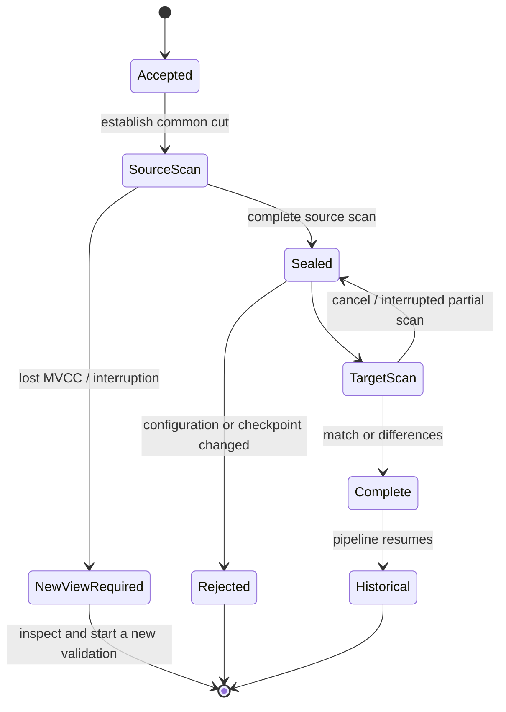

# Managed data validation

The first management workflow supports SQL destination selection, time/staging budgets, durable background jobs, cancellation, sealed-source target retries and per-table summaries. Validation does not change business rows; see [managed repair](/docs/en/reference/managed-repair.html) for the subsequent reviewed workflow. Constraint rebuilding and business cutover remain open. Consult [transaction skipping](/docs/en/reference/transaction-skip.html) for its separate SQL recovery profile. Managed HTTP/database acceptance is separate; earlier CLI/barrier acceptance cannot establish it.

## Use the console

1. Complete V3 snapshots, run the local Worker and verify shared RUNNING state. Selected destinations must be able to reach the common cut; unselected destinations can be paused/offline.
2. As ADMIN, select transactional SQL destinations under Data validation. Messaging/analytical destinations are excluded. First native row profiles cover MySQL/PostgreSQL; other SQL product versions/modes require separate acceptance.
3. Set source-gate, source-read and per-target-table deadlines plus logical/per-row budgets. Gate maximum is120seconds, reads24hours, rows32MiB. Total logical budget must be at least four times the row budget and includes source, destination and keyless identity records. Physical storage is additional.
4. Start comparison. After checking the current configuration revision, scope, report ID and budgets are persisted before execution in a separate background queue. Establishing the cut briefly blocks MySQL instance writes; business writes can continue after gate release while replication retains its durable pause.
5. Follow operation history, then open the report. Results show source/target counts and missing/extra/changed rows per table,50table results per page. A historical result does not establish current equality.
6. Inspect results/shared state and explicitly resume using the current error version. Validation never clears/repairs business tables, rebuilds UNIQUE or transfers write ownership.

## Cancel and recover

Cancel is a durable request, not resume. Owned read connections/locks are aborted and complete sealed source data is retained. The response does not guarantee release at an exact millisecond:driver/connect/network timeouts also matter. Observe task state and database sessions.

Cancellation before establishing a barrier can leave shared RUNNING state; the controller stops its local Worker and displays actual shared state. Once a barrier is established, cancellation never bypasses PAUSED.

A sealed source allows Retry target comparison after loading the report. Original configuration/positions/epoch/physical target checkpoints and source integrity are checked; partial destination scans are discarded and reread, even with the source offline. The report's staging budget is retained; retries default to ten minutes per target table. Existing-report quota expansion and richer retry planning remain pending.

An incomplete source MVCC view cannot survive process loss. Keep the failed report, inspect/explicitly resume as appropriate, and establish a new cut. Never mix source views or rewrite report hashes/GTIDs. Controller restart can reuse a report ID when complete source data survived but the operation completion did not; without a complete source view/local Worker, it fails explicitly rather than resuming the shared pipeline. One validation runs at a time; ordinary controls use a separate pool.

## Access, audit and storage

ADMIN starts/cancels/retries; OPERATOR/VIEWER read summaries only for granted tasks. Cross-task access is hidden. Mutations require current revision and request ID; replay does not create another job. Previously accepted asynchronous work can continue after authorization changes; subsequent requests use current grants.

Audit records actor, task, report ID, request hash and acceptance/completion/cancellation/read events. Corresponding audit writes are required before the HTTP response. Raw business values are excluded from summaries/history.

Reports live under `platform.dataDirectory/validations/<taskId>/<reportId>`. Private plaintext H2 files need protected persistent disk/PVC and coordinated backup; no encryption/external immutable anchor is provided. The console retains approximately40recent operations per task. Older files remain and known report IDs are readable through the API; full report catalogs/retention, large-directory pagination and controller HA remain pending. Local file locking is not cluster HA.

## API

POST `/api/tasks/<taskId>/actions` with `X-Request-ID` and current `expectedRevision`:

```json
{"action":"VALIDATE","expectedRevision":"<revision>","validation":{"targets":["postgres"],"gateMillis":30000,"sourceMillis":3600000,"targetMillis":600000,"limits":{"maximumBytes":1073741824,"maximumRows":1000000000,"maximumRowBytes":4194304}}}
```

Retry uses `VALIDATE_RETRY` and `validation:{"reportId":"<UUID>","targetMillis":600000}`. Cancel uses `VALIDATE_CANCEL` without validation input. GET `/api/tasks/<taskId>/validations/<reportId>` reads a summary. `VALIDATION_REPORT_NOT_CREATED` means inspect the operation failure; `VALIDATION_REPORT_BUSY` means retry after the active scan.

[Core contract and FAQ](/docs/en/reference/reconciliation-workflow.html) / [中文](/docs/zh/reference/managed-validation.html)


## Job recovery paths




First native managed acceptance passed LOCAL/H2 and external PostgreSQL/MySQL/openGauss journals with MySQL8.4/PostgreSQL17 destinations, including cancellation during an actual relation-lock wait, sealed-source retry and report/audit persistence across controller restart. See [evidence and failure corrections](/docs/zh/evidence/baseline.html).


## Administrator difference details

For a completed report, ADMIN can open differences per target/table, page by identity hash, then explicitly reveal raw values. Stored source column names/types accompany expected/actual cells. An absent row is distinct from a present SQL NULL cell. Keyless source/target occurrence IDs are displayed without generating replacements.

POST `/api/tasks/<taskId>/validations/<reportId>/differences` with `{"target":"postgres","tableId":"<table ID>","after":"","limit":25}` returns items/next; maximum limit is100. POST `.../values` with the target/table and identityHash returns columns and expected/actual cells. Null for an entire side means absent row; cell value:null means SQL NULL. OPERATOR/VIEWER remain limited to summaries.

Before releasing values, the server checks difference hashes, raw-row checksums and row identity and requires report/scope-linked audit. Business values never enter audit/controller operations. The API checks total UTF-8 raw JSON lengths before fetching CLOBs and refuses more than1MiB with VALIDATION_DETAIL_TOO_LARGE; it never truncates or substitutes an empty row. Large-row chunking/streaming export remains pending; complete private report data is retained. Values remain in page memory and are cleared on logout. These are historical cut values, not live queries or repair.

Repair is separate from read-only validation. The new [managed repair workflow](/docs/en/reference/managed-repair.html) requires plan review and explicit confirmation;validation itself never changes destination data.
