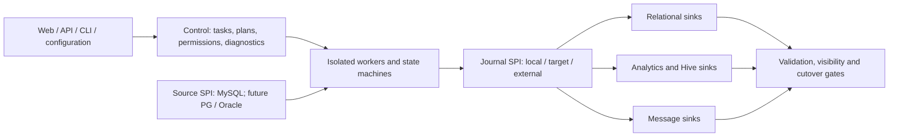

# Rivomesh complete product and technical design

Updated: 2026-11-15. 中文：[完整方案](/docs/zh/reference/platform-design.html). See [requirements](/docs/en/reference/implementation-status.html) for decisions and status.

**This is the full design, not a claim that every feature is complete.** V3 now supports multiple explicitly mapped databases within one logical MySQL source, fan-out, multiple configurations with isolated workers, optional durable journals and Web management. The v2 single-database/single-target mode remains compatible. See [implementation status](/docs/en/reference/implementation-status.html) and [validation](/docs/en/reference/validation.html) for each adapter's accepted scope, and the [console manual](/docs/en/reference/console-and-deployment.html) for operations. Remaining capabilities follow the phases below.

## 1. Product and scope

Rivomesh serves enterprise/government database migration, continuous replication, data distribution, validation, and cutover orchestration. A bilingual Web workbench guides ordinary installations; configuration files, APIs, and CLI use the same model for experts.

| Dimension | Scope |
|---|---|
| Current delivery source | MySQL, including existing 8.0/8.4 coverage; standalone, GTID replication, single-primary MGR |
| Future sources | PostgreSQL and Oracle; design Source SPI and neutral event/position models now, without claiming available connectors |
| Relational targets | MySQL, PostgreSQL, openGauss, distributed GaussDB, DM, Kingbase, OceanBase, GBase; profile product/version/mode/engine separately |
| Analytics/warehouse targets | ClickHouse, Apache Doris, Apache Hive; classify GBase analytical/transactional variants by actual capabilities |
| Current delivery message targets | Kafka, Pulsar, RabbitMQ, RocketMQ, ActiveMQ (separate Classic/Artemis profiles), Redis Streams, NATS JetStream |
| Deployment | Linux manual, Docker, Kubernetes Helm, native Kubernetes manifests |
| Storage | Local durable journal, eligible target-hosted journal, independent shared journal |

Broad version coverage means an expanding compatibility matrix and capability detection, not unconditional support for every historical release/fork/combination. Mark features verified/experimental/unverified/unsupported and identify actual products, versions, modes, drivers, hardware, and recovery boundaries. JDBC connectivity is insufficient acceptance evidence.

## 2. Multiple tasks and targets

Each independent configuration defines one logical source, object selection, multiple targets, mappings, storage, and resource policy. Different configurations may connect to independent MySQL clusters. Support standalone task processes and a console managing isolated workers. Never implicitly merge sources into one transaction or destination table.

Tasks, subscriptions, tables, targets, configuration revisions, and stream generations have independent identities. Candidate endpoints belong to one topology; database mappings are explicit. Preflight detects overlapping destination writers, replication loops, changed source identity, and fingerprint conflicts. New targets establish their own baselines. Isolate rate, connection/thread, memory, and disk quotas per task.

Independent configurations capture separately by default. Explicit capture sharing may follow after validating privileges, filters, retention, source identity, and recovery dependencies, not merely matching hosts. Preserve cross-database transaction atomicity only within a target scope supporting it; no cross-target global XA.

## 3. Modules and contracts

- Source SPI: discover capabilities/objects, create consistent baselines, capture transactions/DDL, encode/restore positions, validate failover, acknowledge upstream. GTID is not a universal source abstraction.
- Journal SPI: persist complete transactions/large-transaction fragments, publish atomically, checksum, recover, enforce quotas, and reclaim. Advance safe capture only after durable completion.
- Sink SPI: capability/object planning, write/publish, resolve uncertain commits, idempotency/versioning, DDL recovery, visibility. Model transactional writes, versioned materialization, batch publication, and messaging explicitly rather than assuming JDBC transactions everywhere.
- Control/Worker: leases/fencing, isolation, configuration revisions, resource scheduling, and recoverable operation logs. Console outages must not destroy deployed worker checkpoints.
- Validation/Cutover: baselines/barriers, differences, restored constraints, write ownership, and audit.

Event envelopes carry logical sourceId, streamGeneration, transaction identity/ordinal, schemaVersion, table identity, operation, before/after, field-presence bitmap, snapshot/DDL/transaction boundaries, source position, and origin. IDs remain stable across retries and physical source failover; new baselines/lineages use new generations. Timestamps are observational, not ordering authorities.

Positions are versioned typed payloads: MySQL GTID/dependencies, PostgreSQL LSN/slot/database/instance lineage, Oracle SCN/transaction/redo context, interpreted by their adapters. Do not compare them lexically or retain only the maximum observed SCN/LSN while losing open long transactions. Snapshot fragments also require stable IDs, completeness markers, and checkpoints.

Future PostgreSQL capture must handle exported snapshots, slot/WAL retention, REPLICA IDENTITY, unchanged TOAST fields, and failover-slot readiness. Oracle requires supplemental logging, redo/archive coverage, long transactions, RAC/CDB/PDB, LOBs, and lineage. Official references describe readiness requirements for PG slots and supplemental logging for Oracle CDC. [PostgreSQL](https://www.postgresql.org/docs/current/logical-replication-failover.html), [Oracle CDC reference](https://debezium.io/documentation/reference/stable/connectors/oracle.html). Review driver/capture distribution terms separately; future connectors are not existing failback channels.

## 4. Target capabilities and consistency

| Target class | Write design | Boundary shown in UI |
|---|---|---|
| MySQL/PG/domestic transactional databases | Dialect-specific batches or native upsert; local apply checkpoint commits with business data | Source-transaction atomicity within supported target scope; central control storage does not replace the local checkpoint |
| ClickHouse | Stable materialization identity, monotonic version, delete markers; engine-specific replacement/read views | Background ReplacingMergeTree merges do not guarantee deduplicated raw reads; validated FINAL/view contracts, no assumed cross-table transaction |
| Doris | Validated Unique Key/Merge-on-Write, sequence, deletes, Stream Load batch protocol | Detect actual single/multi-table commit scope; resolve labels/txn state, timeouts, and retention windows per version |
| Hive | ACID capability mode or immutable file/partition/snapshot publication | Ordinary tables are not row-oriented replicas; profile update/delete, visibility, transactions, and compaction |
| Messaging | Publish change events and transaction/snapshot boundaries with stable IDs | Publisher confirmation is not downstream business completion; at-least-once by default, consumers must be idempotent |

ClickHouse replacement uses ORDER BY; mutable attributes or unstable partitioning cannot define row identity. Keep routing stable and coordinate old-version/tombstone cleanup with the oldest replayable position. [Official engine guide](https://clickhouse.com/docs/guides/replacing-merge-tree).

Doris Unique Key is a row-materialization model, distinct from a relaxable source business secondary UNIQUE. Do not mechanically replace it with Duplicate Key. Resolve lost acknowledgments against actual commit state; expired labels are not permanent deduplication evidence. [Sequence columns](https://doris.apache.org/docs/4.x/data-operate/update/unique-update-concurrent-control/), [load transactions](https://doris.apache.org/docs/dev/key-features/load-transaction.html/). These references do not guarantee every older version.

Hive publication records batches, file manifests/digests, partitions, schemas, and metadata commit state. Readers must not see temporary files; object storage cannot be assumed to provide atomic rename. Recovery reconciles files/catalog to prevent duplicates, partial batches, and orphans. ACID mode instead uses validated transaction APIs/configuration and compaction. [Hive Transactions](https://hive.apache.org/docs/latest/user/hive-transactions/). Analytical targets default to data-service/warehouse output, not unverified OLTP application takeover destinations.

Expose captured (durably collected), delivered (accepted), applied/materialized, visible under the declared read contract, and validated at a barrier as supported. A single success indicator must not hide these differences.

## 5. No-PK tables, JSON, generated columns

All three are first-release requirements needing development; current code rejects them. Removing validation does not implement support.

| Identity class | Planned strategy |
|---|---|
| Primary key | Stable keyed scan/lookup, including key changes |
| No PK but a reliable all-NOT-NULL unique candidate | Validate semantics, use it as identity, handle changes; do not casually relax this identity constraint |
| No unique key; identical duplicate rows allowed | Consistent baseline, multiset semantics, durable technical identities/counts, exact before-image matching; each change modifies one occurrence |

A target auto-ID, unique whole-row hash, or online OFFSET cursor cannot solve keyless identity. Hashes only accelerate candidates; compare full typed values and preserve multiplicity. Never delete every equal row for one logged deletion. Added technical columns require explicit mappings/views and dependency checks; they cannot be claimed invisible to SELECT *.

Keyless snapshotting needs a replayable consistent artifact coordinated with the log baseline. Persist fragments/manifests before loading and replaying later transactions; deduplicate imports by fragment/transaction identity. If a source MVCC snapshot disappears with its connection, a row number cannot restore it. Resume completed artifacts or rebuild that table at a provable new baseline without resetting unrelated completed subscriptions. The same applies to failover during an unfinished keyless snapshot. Explain required coordination privileges, possible short locks/rescans, and disk costs; do not promise arbitrary keyless tables lock-free exact row-cursor recovery. [MySQL row-search behavior](https://dev.mysql.com/doc/refman/8.4/en/replication-features-row-searches.html) is a design reference, not reused storage internals.

JSON: decode MySQL binary JSON correctly, preserving numeric precision, SQL NULL versus JSON null, array ordering, and characters. Map to native JSON or text/LOB with declared query differences. Compare using documented semantic normalization rather than object-key ordering/whitespace. Initially require full JSON logging and retain empty binlog_row_value_options unless partial-patch/historical-base recovery is implemented. [MySQL JSON replication](https://dev.mysql.com/doc/refman/8.4/en/replication-features-json.html).

Generated columns: distinguish STORED/VIRTUAL, actual logged presence/values, dependencies, and schema versions. Choose proven equivalent target expressions or ordinary-column materialization. Missing logged values require evaluation from historical inputs, never a later SELECT of the source's current row. Translation/evaluation covers SQL mode, collation, time zones, precision, and JSON functions; unsupported expressions produce precise blockers/alternatives, never silent NULLs. Do not INSERT explicit values into native target generated columns. Record takeover differences between materialized ordinary columns and native generation. [MySQL generated columns](https://dev.mysql.com/doc/refman/8.4/en/create-table-generated-columns.html).

## 6. DDL, existing targets, constraints

Discover/version table definitions, indexes, expressions, and dependencies. Ordered DDL needs schema barriers and recoverable operation logs. Classify transformations as automatic, planned migration, or blocked; never forward arbitrary source SQL. Reconcile catalogs after nontransactional DDL, restarts, and uncertain responses.

Existing-target paths: compatible empty tables; nonempty staging/shadow comparison/publication; explicit merge policies using reliable keys; or incremental onboarding with proven matching data and log position. Entering a GTID without a verified baseline is insufficient. Keyless merges require multiset rules, not guessed upserts. Report extra/conflicting rows and trigger/FK side effects before changing anything; no automatic clearing.

Relax Gauss business secondary UNIQUE to ordinary indexes; permit capability-driven relaxation for incompatible constraints on other targets, retaining original definitions. Preserve PK/candidate identity, internal deduplication, and required analytical materialization keys. Report missing equivalents instead of inventing indexes. See [index policy](/docs/en/reference/gaussdb-index-policy.html) for GSI and constraint restoration.

## 7. Three journal deployment modes

| Mode | Use | Availability/recovery limits |
|---|---|---|
| LOCAL | Single-host/Docker without extra services; persistent directory/PVC | Process recovery; cross-node takeover requires original logs, authoritative owner verification, and old-writer fencing, otherwise automatic HA is disabled |
| TARGET | Reuse a validated transactional target's metadata schema | No independent store, but its outage may block capture; not the default for ClickHouse/Hive/MQ-only tasks |
| EXTERNAL | Independent HA journal/state adapter and worker takeover | Better isolation, but validate backend/acknowledgment/reclamation; arbitrary shared folders/object stores are not inherently safe journals |

Durable acknowledgment, checksums, transaction completion, stream sequence, and ownership form one protocol. Spill large transactions to durable fragments without marking partial transactions captured. Transactional sinks must not split an atomic source transaction just to save memory. Diagnose limits or use an explicitly supported mode rather than OOM and lose recovery context.

Reclaim according to the slowest active subscription and baseline dependencies. Alert/backpressure near quotas and show retention headroom. Abandoning a target's history requires an explicit resnapshot plan. A message broker as sink and as internal journal are different roles; a sink connector does not automatically implement its journal backend.

## 8. Seven messaging families

| Target | Adapter concerns |
|---|---|
| Kafka | Partitioning, durable acknowledgments, producer idempotence/transactions, transactional-ID fencing, schema/compression; restart/external-checkpoint recovery still required |
| Pulsar | Partition/routing, stable producer identity/sequence, persistent topics, deduplication windows/transactions |
| RabbitMQ | Durable queues/messages, publisher confirms, mandatory/returns, uncertain resend after reconnect, bindings |
| RocketMQ | Versioned normal/FIFO support, routing keys, acknowledgment/retry; transactional messages do not automatically couple source-log commits |
| ActiveMQ Classic / Artemis | Separate protocol/driver profiles, persistent messages, session/send acknowledgments, transactions/reconnect; Artemis features do not imply Classic parity |
| Redis Streams | XADD, persistence/replication, streams/groups and retention; generated stream IDs do not replace eventId |
| NATS JetStream | Durable streams, publish acknowledgment, subjects/consumers, deduplication IDs/windows, quotas; not ephemeral Core NATS |

The common contract is at-least-once publication with stable eventId and consumer idempotency by event ID/row version. Start with JSON envelopes and allow Avro/Protobuf/schema-registry plugins without a mandatory registry. Preserve type information and notify versioned schema/DDL changes.

Choose per-table/key ordering or whole-transaction single-partition routing. Partitions, redelivery, and concurrent consumers do not imply global order. Large messages/transactions require transaction IDs, fragment ordinals, completion counts/markers, and checksums; atomic consumer application waits for complete assembly. Boundary records identify filtering scope so consumers do not wait for excluded rows.

Kafka/Pulsar broker transactions, deduplication windows, or idempotent producers do not automatically provide end-to-end exactly-once across source, broker, and arbitrary consumer databases. RabbitMQ explicitly documents duplicates after lost confirmations. [RabbitMQ reliability](https://www.rabbitmq.com/docs/reliability). Every adapter needs uncertain-commit recovery tests.

Redis Streams and JetStream have their own retention, acknowledgment, persistence, and deduplication configurations; API availability is not durable-delivery validation. [Redis Streams](https://redis.io/docs/latest/develop/data-types/streams/), [JetStream](https://docs.nats.io/concepts/jetstream). Validate ActiveMQ variants separately: [Classic transactions](https://activemq.apache.org/components/classic/documentation/should-i-use-transactions), [Artemis deduplication](https://artemis.apache.org/components/artemis/documentation/latest/duplicate-detection.html).

Never skip bad messages by default. Missing routes, oversized messages, and serialization failures pause publication with guided UI repair. Any future quarantine-and-continue mode must retain replayable events and explicitly downgrade transaction/completeness guarantees. Broker retention/consumer completion are separate monitoring layers after publication; publish progress must not claim every subscriber has processed an event.

## 9. Fault model

Cover source promotion/replication I/O and SQL errors, split writers, process/node failure, target outages/SQL errors, uncertain commits, disk full/corruption, interrupted DDL, lost MQ acknowledgments, duplicates/reordering, partial analytical batches, upgrades, and backup rollback.

Retry transient errors with backoff; pause affected subscriptions for deterministic issues. Restarts/standby activation never bypass pause. UI exposes cause, scope, last safe positions, backlog, and recommended actions, then retries the original unit after repair. Do not offer casual position editing/transaction skipping. External database HA owns promotion/old-primary isolation; CDC cannot reconstruct permanently lost source data.

## 10. Graphical workbench

Wizard: scenario → connections/tests → objects/privileges → compatibility/constraints/storage/sizing → explicit mapping → execution plan → run/diagnose → barrier validation → cutover/handover.

Pages include overview, connections/drivers, tasks/subscriptions, object differences, journal/capacity, indexes/DDL, validation, incident center, cutover plans, deployment diagnostics, and audit. Explain causes/next steps in plain language; experts can expand SQLState/vendor codes and sanitized diagnostics. Stable codes have equivalent Chinese/English explanations.

Pause/resume, retry, mapping/concurrency changes, object repair, table rebuild, validation, and cutover use authorized APIs with request IDs, expected configuration versions, idempotency, background-operation state, and audit. Browsers never edit metadata tables directly. Destructive plans show affected objects/recovery points without default data deletion. CLI/files use the same service contract for automation/offline operation.

Separate viewer, operator, migration, and credential roles. Never put passwords in logs/plain exports. Provide offline help, diagnostic bundles, metrics/alerts; telemetry upload is not a runtime requirement. UI recovery does not replace database administrators repairing source replication.

## 11. Linux, Docker, Kubernetes

Linux delivery includes distributions, configuration, start/status/stop/upgrade procedures, and systemd. Docker includes pinned images, health checks, durable mounts, and credential injection. Declare x86_64/ARM64, JDK/driver, and native dependencies only after validation; Java bytecode portability does not prove native-library portability.

Deliver both Helm Chart (values/schema, templates, upgrades, persistence options) and native YAML (applicable ConfigMaps, Secret references, Services, workloads, probes, RBAC, PVCs), usable with kubectl apply. Maintain both through the same configuration model and render/consistency checks. Test defaults/local volumes/external storage/HA/upgrades; screenshots or hand-written-resource instructions are insufficient.

Local authoritative journals require recoverable volumes and single-writer policy; shared-journal workers may have no authoritative local state. Replica count is not safe takeover, and RWO is not fencing. Validate/version configuration/Secret changes. Graceful stop completes or rolls back the current safe unit and releases ownership. Separate liveness, readiness, and subscription status to avoid restart storms during source outages or pauses.

Support private registries, offline dependencies/driver packages, and certificates. Cryptographic, OS/CPU, and vendor certifications require actual dependency/testing records; do not claim certification by default.

## 12. Hardware/performance standard

Deliver benchmark tools, workload definitions, raw reports, and sizing guidance rather than invented rows-per-core figures. 4C/8GiB, 8C/16GiB, and 16C/32GiB may be **experimental tiers**, not measured throughput or production minimums. Record source, worker, journal, and each target's hardware separately.

Record CPU model/architecture/quota, RAM/heap, disk type/capacity/measured bandwidth/IOPS/durability settings, network RTT/bandwidth, product/driver versions, tables/indexes, row width, JSON/LOB, identity class, transaction sizes, operation mix, target count, batches/concurrency, and acknowledgment policy.

Measure snapshot rows/s and MiB/s, CDC events/s and transactions/s, end-to-end p50/p95/p99 latency, visibility delay, backlog growth, takeover/catch-up time, resource use, source business impact, and final validation. Separate keyless, fan-out, MQ, JSON, and transaction-size cases. Narrow single-table benchmarks cannot represent all deployments.

For backlog B, incoming rate r, and apply capacity c in matching units, sustained catch-up requires c>r; ideal catch-up time is B/(c-r). Journal sizing approximates durable log rate × required retention plus active snapshot artifacts, large-transaction staging, index/metadata space, and margin, adjusted for measured compression/write amplification. More hardware cannot remove hot-key ordering, source/target bottlenecks, or network limits.

## 13. Migration, parallel service, extensions

| Scenario | Boundary and extension |
|---|---|
| Online migration/read-only mirrors | Snapshot+CDC, data/object reconciliation, secondary-constraint conversion, migration reports |
| Both environments serving reads | One authoritative writer; route reads according to table/target watermarks and explicit staleness budget |
| Gradual/domain cutover | Explicit table/domain ownership, application routing, cross-domain transaction boundaries; service does not silently change application endpoints |
| Independent writers to the same table | Requires bidirectional capture, conflict rules, origin/loop prevention, key allocation, repair; two opposing tasks are insufficient |
| Failback after cutover | Before new business writes, planned routing rollback may suffice; afterwards require verified reverse capture/compensation and validation |
| Real-time warehouse/events | ClickHouse/Doris/Hive and all seven messaging families with traceable events/schemas |
| Application compatibility | SQL/object assessment, read-only shadow queries, interface regression, performance reports; data migration does not automatically port application SQL |

Cutover gates include freezing relevant source writes/DDL, final barriers, target apply/visibility, data validation, restored constraints/generated behavior, synchronization fencing, and application handover. Open new writes only after required gates pass; do not promise automatic application changes or unconditional zero downtime.

Extensions include lineage/audit, history/CDC archiving, data-quality rules, masked distribution, rehearsals, and capacity forecasts. Transformations/masking mark outputs as transformed, not exact mirrors. PostgreSQL/Oracle capture should be later connector milestones before corresponding reverse paths can be validated. Active-active conflict merging and cross-environment global transactions are separate advanced projects, not implied first-release guarantees.

## 14. Delivery sequence and completion

| Phase | Delivery/acceptance |
|---|---|
| P0 Foundation | Rename, source-neutral events/positions/SPI, capability matrix, configuration versions, task/subscription isolation; preserve existing recovery regressions |
| P1 Correctness/UI foundation | Keyless/JSON/generated columns, baseline/DDL recovery, relational targets, wizard/incidents; object/transaction/fault matrix |
| P2 Storage/distribution | Three journals, fan-out, all in-scope MQ, ClickHouse/Doris/Hive; lost ACK/duplicates/reordering/partial batches/quotas |
| P3 Migration closure | Existing targets, validation/repair, constraint restoration, cutover gates/audit, Linux/Docker/Helm/native YAML, full bilingual manual |
| P4 Performance/product acceptance | Hardware benchmarks, soak/fault/upgrade matrix, security configuration/offline delivery; truthful status per target |
| Later source milestones | PostgreSQL/Oracle connectors and snapshot/long-transaction/failover acceptance before verified reverse paths |

Phasing does not demote in-scope message targets or objects to optional suggestions. Every stage delivers runnable functionality, matching UI, bilingual documentation, and fault tests. Do not mark design-only adapters available. Apache preparation separately includes name review, community/governance, ownership/dependency terms, LICENSE/NOTICE, reproducible builds, and test infrastructure. Rivomesh is not currently an Apache project. [ASF naming](https://www.apache.org/foundation/marks/naming.html).
