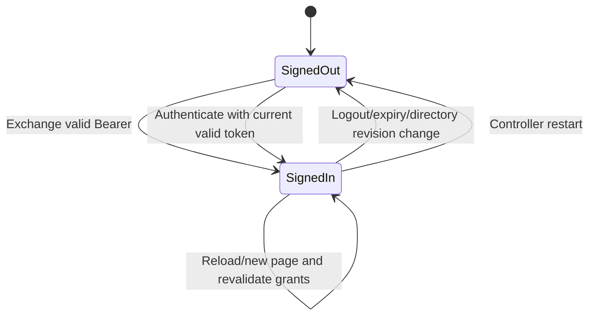

# SE-01/02/03/05: single-controller session design

[中文](/docs/zh/sdd/design-sessions.html) · [Specification](/docs/en/sdd/spec.html) · [Operations](/docs/en/reference/browser-sessions.html)

This implementation closes reload recovery, single-controller session lifecycle, protected transport and existing API compatibility. SE-04 and the CP shared control authority remain unfinished; MemoryStore is not shared control storage. Restart requires sign-in again without changing task/account/audit storage formats.

## State and interfaces

`BrowserSessions.Store` defines insert/find/touch/remove/close. The bounded in-memory implementation purges expired entries. Keys are SHA256 digests of256-bit random session IDs; values contain principal/directory revision, random CSRF value, last activity and absolute expiry. Raw session IDs and API tokens are not retained. Both session IDs and CSRF values use32-byte SecureRandom and unpadded URL-safe Base64.

Every request checks the candidate session against the current TaskService account directory: user exists, is enabled and has the same directory revision. Any directory mutation strictly revokes all older sessions. Task commit retains existing currentActor revision checks. Explicit Bearer never falls back to cookies; two valid but different identities are rejected. Audit stores identity/outcome without authentication material.

A future shared backend must provide atomic bounded creation, expiry/touch/revocation and consistent authorization checks integrated with shared accounts, audit and command authority. Replacing the interface with another Map or mounting a shared directory cannot close SE-04. The complete shared control-state contract and migration protocol remain CP-02 work; empty interfaces are not counted as implementation.

## HTTP and page contract

POST /api/session requires Bearer, GET /api/session accepts Bearer or cookies, and POST /api/session/logout requires cookies. Production defaults use the __Host prefix, Secure, HttpOnly, SameSite=Strict, Path=/ and no Domain. Explicit local HTTP uses a different cookie name. Proxy publicOrigin is the exact external origin; forwarded headers are not trusted. Cookie mutations require both Origin and CSRF checks. The proxy terminates production TLS.

Startup restores the server session and grants without reading a saved token; invalid sessions show sign-in. Language preference is the only persistent Web Storage value. API requests carry a page-session generation so late responses cannot mutate a newer identity. Refresh locks also use generations, preventing an old refresh from blocking a new login.

Sign-in, sign-out and reauthentication after self-token rotation use one authentication queue. Sign-out clears UI state immediately, waits behind outstanding login, obtains the current CSRF credential and revokes that cookie, including a delayed login result. BroadcastChannel sends only a sign-out signal; recipients clear state and queue revocation without broadcasting secrets. Server sign-out failures show bilingual retry guidance. A confirmed self-token rotation may exchange the newly saved token for a completely new session; the previous session remains invalid.

## Acceptance scope

- Eight real HTTP contract tests cover restoration, Origin/CSRF refusal, roles, identity conflicts, no fallback, directory-wide revocation, rotation/disable/grant changes, self-rotation, disabled sessions, restart invalidation, expiry/capacity and configuration validation.
- Those eight tests run against the same candidate JAR on Java8/11/17/21/25. This is a session profile, not the full source/target/JDK matrix.
- A TLS proxy and real CookieJar verify HTTPS cookies, withholding Secure credentials on HTTP, CSRF/Origin refusal, replay refusal after logout, Bearer compatibility and absence of plaintext credentials in state.
- DOM coverage includes reload/new pages, sign-out, multiple tabs, late401/login/refresh, failed server sign-out and self-token rotation, preserving editor/audit/validation/repair tests.
- Artifact checks, root and artifact-first tests, Helm/native parity and the updated Docker preview are archived separately.

Full-browser visual/accessibility, live Kubernetes/CSI, shared controllers/sessions, OIDC and human-inactivity detection remain outside this acceptance. Historical gaps stay open.
