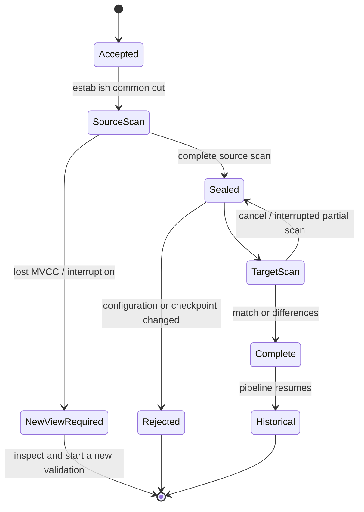

# 管理界面数据校验

管理端已接入逐行校验作业：选择事务型 SQL 目标、设置时间/暂存预算、后台执行、请求取消、继续已密封源数据的目标比对，以及查看分表摘要。校验本身不修改业务数据；后续审阅修复见[管理端修复](/docs/zh/reference/managed-repair.html)。约束重建与业务切换待实现。[事务跳过](/docs/zh/reference/transaction-skip.html)有独立的 SQL 恢复档案。 管理端真实 HTTP/数据库联合验收单独记录；旧 CLI 屏障/比对验收不能代替它。

## 页面操作

1. 在 V3 任务中先完成全量同步，启动本机 Worker，确认共享状态为 RUNNING。校验前所选目标应能追平源位点；其他目标可以独立暂停/离线。
2. 管理员在任务详情的“数据校验”中选择目标。消息及分析目标不列入选择。MySQL/PostgreSQL 是首批真实逐行验收目标，其他 SQL 产品的模式/版本仍需单独验收。
3. 设置源写锁上限、源扫描上限、每个目标表扫描上限、暂存逻辑预算和单行预算。源写锁最大120秒，读取最大24小时，单行最大32MiB；总逻辑预算至少是单行预算的4倍。源、各目标和无主键身份都会占用预算，物理数据库空间另计。
4. 点击“开始逐行校验”。服务核对当前配置 revision 后，先持久保存请求、报告 ID、目标范围和预算，再由独立后台队列执行。源写锁会短时阻塞 MySQL 实例写入；释放源锁后业务可继续写，复制保留共同暂停点。
5. 在操作记录中查看状态。完成后点击“查看报告”，按目标/表查看源行数、目标行数、缺失、多余和内容变更。表结果每页50项；摘要包含历史校验点的结果，不表示当前仍相等。
6. 检查报告和共享状态，使用当前错误版本显式恢复同步。校验不会自动清空/修复业务表，也不会重建 UNIQUE 或交接业务写入。

## 取消与恢复

“取消校验”是持久取消请求，不是恢复同步。服务会中止本次读取、释放自己持有的连接/锁，并保留已经保存的完整源数据；取消的返回不代表已在某个精确毫秒完成，连接、网络和驱动的超时也会影响释放，应观察任务和数据库会话。

如果取消发生在屏障建立前，共享任务可能仍是 RUNNING；控制节点停止本机 Worker，并在页面显示实际共享状态。已经建立屏障后，取消不绕过其 PAUSED 状态。

完整源数据已经密封时，加载报告后可点击“继续目标比对”。服务校验原配置/位点/epoch/物理目标断点，验证源密封，丢弃部分目标扫描后重新读取；源库在这一阶段可以离线。重试使用报告原有暂存预算，默认目标表扫描上限为10分钟；扩容旧报告及更完整的重试计划界面仍待实现。

未完成源扫描的 MVCC 视图在进程退出后无法重建。报告会要求新源视图：保留旧报告，检查并显式恢复任务，再开始新的校验。不能混用两个源时间点，也不能直接改报告摘要或同步 GTID。

管理服务重启后，已经保存完整源数据但尚未提交操作结果的作业可沿用报告 ID 继续比对。没有完整源视图且本机 Worker 尚未恢复的作业会明确失败，不会擅自恢复共享任务。作业队列一次执行一个校验，普通任务控制使用独立线程池。

## 权限、审计与存储

- ADMIN 可以开始、取消和继续校验；OPERATOR/VIEWER 可以读取自己获授权任务的摘要，不能发起这些修改。跨任务读取返回不存在。
- 请求使用当前配置 revision 和去重请求 ID；相同请求重放不会创建另一份校验。已接收的异步操作仍可能在账号授权变更后继续，后续请求按最新权限校验。
- 审计记录操作人、任务、报告 ID、请求摘要及接受/完成/取消/读取事件；HTTP 返回前要求相应审计可写。报告原始业务数据不会进入摘要和操作记录。
- 文件位于 `platform.dataDirectory/validations/<taskId>/<reportId>`。目录和 H2 数据为私有明文，不提供加密或外部不可变锚点；需要私有持久磁盘/PVC并协调备份。
- 界面沿用每任务约40条最近操作历史；历史报告文件仍保留，已知报告 ID 的摘要可通过接口访问。完整报告目录/保留策略、大目录分页和控制器 HA 尚待实现，不能把本机文件锁称为跨集群高可用。

## API

`POST /api/tasks/<taskId>/actions`，`X-Request-ID` 必填，JSON 需包含当前 `expectedRevision`：

```json
{"action":"VALIDATE","expectedRevision":"<revision>","validation":{"targets":["postgres"],"gateMillis":30000,"sourceMillis":3600000,"targetMillis":600000,"limits":{"maximumBytes":1073741824,"maximumRows":1000000000,"maximumRowBytes":4194304}}}
```

继续比对使用 `action: VALIDATE_RETRY` 和 `validation: {"reportId":"<UUID>","targetMillis":600000}`；取消使用 `action: VALIDATE_CANCEL`，不传 validation。摘要为 `GET /api/tasks/<taskId>/validations/<reportId>`。尚未创建报告返回 `VALIDATION_REPORT_NOT_CREATED`，被当前扫描占用时返回 `VALIDATION_REPORT_BUSY`；请先看操作记录或稍后重试。

[底层校验契约与 FAQ](/docs/zh/reference/reconciliation-workflow.html) / [English](/docs/en/reference/managed-validation.html)


## 作业恢复路径




首批真实管理端联合验收已通过 LOCAL/H2、外部 PostgreSQL/MySQL/openGauss 四种日志模式，目标为 MySQL8.4/PostgreSQL17，包含真实表锁等待中的取消、同源密封重试及控制器重启报告/审计。完整范围和失败修正见[验收记录](/docs/zh/evidence/baseline.html)。


## 管理员差异详情

完成报告后，管理员可按目标/表打开“查看差异”，按身份摘要分页浏览缺失、多余和变更记录，再显式点击“查看原始值（敏感数据）”。表头按保存的源结构显示字段及类型；整行不存在与字段为 SQL NULL 分开显示。无主键表同时展示源/目标内部行身份，不会补造新的 UUID。

`POST /api/tasks/<taskId>/validations/<reportId>/differences` 接收 `{"target":"postgres","tableId":"<表ID>","after":"","limit":25}`，返回 `items` 和下一页 `next`，limit 最大100。`POST .../values` 接收相同目标/表以及 `identityHash`，返回 columns 与 expected/actual 单元格数组；整行缺失用 null，存在行中的 SQL NULL 用单元格 value:null。仅管理员可访问这两个接口，普通运维/只读账号只能读取摘要。

原始值返回前会校验差异哈希、原始行校验和及行身份，并要求写入带报告 ID、目标/表/身份范围摘要的审计。业务值不写入审计或控制器操作记录。界面请求先检查两侧原始 JSON 的 UTF-8 大小，总计超过1MiB则返回 `VALIDATION_DETAIL_TOO_LARGE`；不截断、不伪装成空行。大行分块/流式导出尚未实现，私有报告中的完整数据仍保留。已加载的值只在当前页面内存中，退出登录会清除。这里显示历史校验点的原始值，不是实时查询，也不会修复数据。

修复操作独立于只读校验。已新增[管理员修复流程](/docs/zh/reference/managed-repair.html)，需要审阅计划并显式确认；校验本身不会修改目标。
