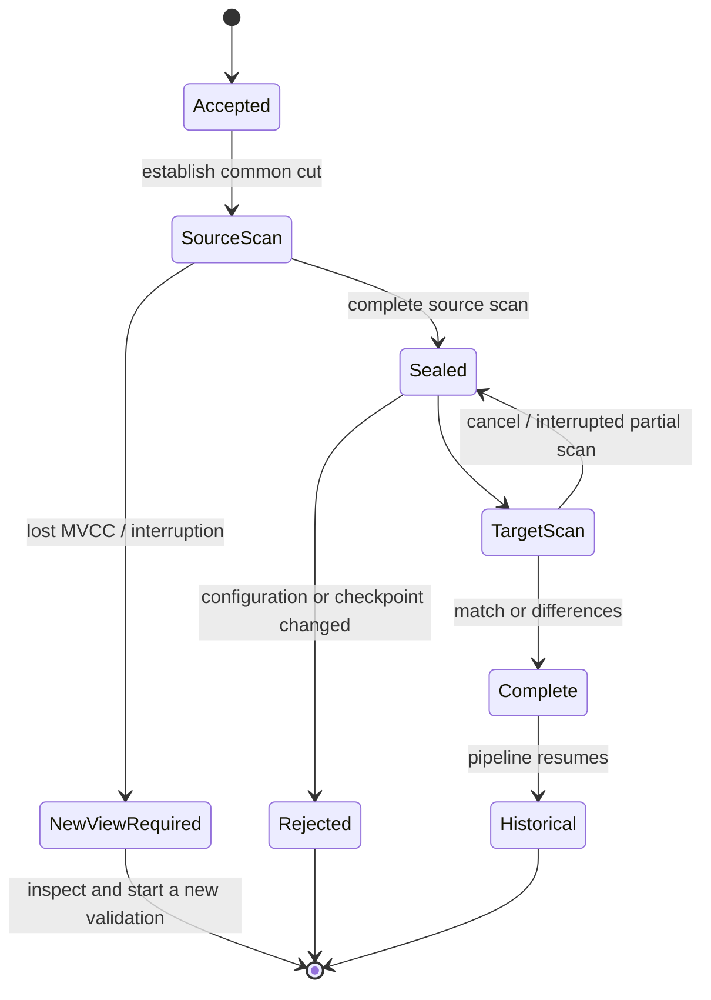

# 管理界面数据校验

可在管理界面选择事务型 SQL 目标、设置时间和暂存预算、运行或取消后台校验、用已密封的源数据继续比对，并查看分表摘要。对共同校验点的差异进行修复时，使用[管理端修复](/docs/zh/reference/managed-repair.html)。MySQL 源事务卡住时，参阅[源采集恢复](/docs/zh/reference/capture-recovery.html)。

## 页面操作

1. 在 V3 任务中先完成全量同步，启动本机 Worker，确认共享状态为 RUNNING。校验前所选目标应能追平源位点；其他目标可以独立暂停/离线。
2. 管理员在任务详情的“数据校验”中选择目标。消息及分析目标不列入选择。MySQL/PostgreSQL 是首批真实逐行验收目标，其他 SQL 产品的模式/版本仍需单独验收。
3. 设置源写锁上限、源扫描上限、每个目标表扫描上限、暂存逻辑预算和单行预算。源写锁最大120秒，读取最大24小时，单行最大32MiB；总逻辑预算至少是单行预算的4倍。源、各目标和无主键身份都会占用预算，物理数据库空间另计。
4. 点击“开始逐行校验”。服务核对当前配置 revision 后，先持久保存请求、报告 ID、目标范围和预算，再由独立后台队列执行。源写锁会短时阻塞 MySQL 实例写入；释放源锁后业务可继续写，复制保留共同暂停点。
5. 在操作记录中查看状态。完成后点击“查看报告”，按目标/表查看源行数、目标行数、缺失、多余和内容变更。表结果每页50项；摘要包含历史校验点的结果，不表示当前仍相等。
6. 检查报告和共享状态，使用当前错误版本显式恢复同步。校验不会自动清空/修复业务表，也不会重建 UNIQUE 或交接业务写入。

## 取消与恢复

“取消校验”是持久取消请求，不是恢复同步。服务会中止本次读取、释放自己持有的连接/锁，并保留已经保存的完整源数据；取消的返回不代表已在某个精确毫秒完成，连接、网络和驱动的超时也会影响释放，应观察任务和数据库会话。

如果取消发生在屏障建立前，共享任务可能仍是 RUNNING；控制节点停止本机 Worker，并在页面显示实际共享状态。已经建立屏障后，取消不绕过其 PAUSED 状态。

完整源数据已经密封时，加载报告后可点击“继续目标比对”。服务校验原配置/位点/epoch/物理目标断点，验证源密封，丢弃部分目标扫描后重新读取；源库在这一阶段可以离线。重试使用报告原有暂存预算，默认目标表扫描上限为10分钟；扩容旧报告及更完整的重试计划界面仍待实现。

未完成源扫描的 MVCC 视图在进程退出后无法重建。报告会要求新源视图：保留旧报告，检查并显式恢复任务，再开始新的校验。不能混用两个源时间点，也不能直接改报告摘要或同步 GTID。

管理服务重启后，已经保存完整源数据但尚未提交操作结果的作业可沿用报告 ID 继续比对。没有完整源视图且本机 Worker 尚未恢复的作业会明确失败，不会擅自恢复共享任务。作业队列一次执行一个校验，普通任务控制使用独立线程池。

## 权限、审计与存储

- ADMIN 可以开始、取消和继续校验；OPERATOR/VIEWER 可以读取自己获授权任务的摘要，不能发起这些修改。跨任务读取返回不存在。
- 请求使用当前配置 revision 和去重请求 ID；相同请求重放不会创建另一份校验。已接收的异步操作仍可能在账号授权变更后继续，后续请求按最新权限校验。
- 审计记录操作人、任务、报告 ID、请求摘要及接受/完成/取消/读取事件；HTTP 返回前要求相应审计可写。报告原始业务数据不会进入摘要和操作记录。
- 文件位于 `platform.dataDirectory/validations/<taskId>/<reportId>`。目录和 H2 数据为私有明文，不提供加密或外部不可变锚点；需要私有持久磁盘/PVC并协调备份。
- 界面沿用每任务约 40 条最近操作历史。留存报告可按 ID 打开，也可浏览历史目录。Agent 重启后仍需能访问原报告目录。

## API

`POST /api/tasks/<taskId>/actions`，`X-Request-ID` 必填，JSON 需包含当前 `expectedRevision`：

```json
{"action":"VALIDATE","expectedRevision":"<revision>","validation":{"targets":["postgres"],"gateMillis":30000,"sourceMillis":3600000,"targetMillis":600000,"limits":{"maximumBytes":1073741824,"maximumRows":1000000000,"maximumRowBytes":4194304}}}
```

继续比对使用 `action: VALIDATE_RETRY` 和 `validation: {"reportId":"<UUID>","targetMillis":600000}`；取消使用 `action: VALIDATE_CANCEL`，不传 validation。摘要为 `GET /api/tasks/<taskId>/validations/<reportId>`。尚未创建报告返回 `VALIDATION_REPORT_NOT_CREATED`，被当前扫描占用时返回 `VALIDATION_REPORT_BUSY`；请先看操作记录或稍后重试。

[底层校验契约与 FAQ](/docs/zh/reference/reconciliation-workflow.html) / [English](/docs/en/reference/managed-validation.html)


## 作业恢复路径




首批真实管理端联合验收已通过 LOCAL/H2、外部 PostgreSQL/MySQL/openGauss 四种日志模式，目标为 MySQL8.4/PostgreSQL17，包含真实表锁等待中的取消、同源密封重试及控制器重启报告/审计。完整范围和失败修正见[验收记录](/docs/zh/start/verification.html)。


## 管理员差异详情

完成报告后，管理员可按目标/表打开“查看差异”，按身份摘要分页浏览缺失、多余和变更记录，再显式点击“查看原始值（敏感数据）”。表头按保存的源结构显示字段及类型；整行不存在与字段为 SQL NULL 分开显示。无主键表同时展示源/目标内部行身份，不会补造新的 UUID。

`POST /api/tasks/<taskId>/validations/<reportId>/differences` 接收 `{"target":"postgres","tableId":"<表ID>","after":"","limit":25}`，返回 `items` 和下一页 `next`，limit 最大100。`POST .../values` 接收相同目标/表以及 `identityHash`，返回 columns 与 expected/actual 单元格数组；整行缺失用 null，存在行中的 SQL NULL 用单元格 value:null。仅管理员可访问这两个接口，普通运维/只读账号只能读取摘要。

原始值返回前会校验差异哈希、原始行校验和及行身份，并要求写入带报告 ID、目标/表/身份范围摘要的审计。业务值不写入审计或控制器操作记录。界面请求先检查两侧原始 JSON 的 UTF-8 大小，总计超过1MiB则返回 `VALIDATION_DETAIL_TOO_LARGE`；不截断、不伪装成空行。大行分块/流式导出尚未实现，私有报告中的完整数据仍保留。已加载的值只在当前页面内存中，退出登录会清除。这里显示历史校验点的原始值，不是实时查询，也不会修复数据。

修复操作独立于只读校验。已新增[管理员修复流程](/docs/zh/reference/managed-repair.html)，需要审阅计划并显式确认；校验本身不会修改目标。

### 历史校验报告

在 **数据校验** 区域选择 **浏览历史校验报告**，可以按创建时间浏览任务所属 Agent 已留存的报告。原操作离开近期记录后仍可从这里打开，Agent 使用原目录重启后也可继续读取。摘要按任务授权查看。差异明细和业务行值使用管理员权限。

卡片显示报告创建时间。展开 **报告 ID** 可复制标识。已有 ID 时，在历史目录选择 **按报告 ID 打开**，可按当前任务和账号权限读取对应摘要。点 **返回历史目录** 会回到原来浏览的页面。使用键盘浏览时，后台状态刷新会保留同一个仍可用的报告控件焦点。

API 可调用 `GET /api/tasks/{id}/validations?limit=20` 读取元数据，使用 `after` 传入上一页的 `nextCursor`。Agent 再次取得报告锁时清理中断留下的摘要临时文件。请把留存报告和审阅证据纳入任务的受保护备份。

目录按报告 ID 和创建时间分页，查询目录时无需打开 H2 报告库或读取业务值。打开使用中的报告会返回 `VALIDATION_REPORT_BUSY`，等待操作结束后重新打开。管理员可针对指定目标与表使用 **上一页**、**下一页** 浏览差异身份，再为选中的差异显式查看原始值。

报告与恢复证据目前没有自动过期。规划磁盘容量时，请同时考虑留存文件和当前作业的预算。重试、修复计划、缺口核验或审计仍依赖的报告需要保留。报告移出最近操作记录也不会释放报告占用的磁盘空间。

### 检查报告存储

管理员可在报告卡片选择 **查看存储**，也可调用 `GET /api/tasks/{taskId}/validations/{reportId}/storage`。返回报告数据库及已知摘要、诊断文件的观测字节长度。**报告受保护** 表示所属 Agent 观测到本进程正在使用该报告。**活动状态未知** 涵盖其他进程。可用这些观测值规划存储和备份。作业运行期间文件长度可能变化。

### 审阅报告最低保留期限

在持有报告的 Agent 或独立服务器配置 `validationRetentionMinimumDays`。默认值 `0` 关闭新审阅。设置为 1 至 3650 可开启审阅并指定最低天数。Linux、Docker 和原生 Kubernetes 修改平台配置。Helm 部署在所属 Agent 的 release 设置 `platform.validationRetentionMinimumDays`。

打开报告的 **查看存储**，为已完成的报告填写最低保留天数，勾选确认并提交。服务端核对当前任务版本、上次审阅 ID 和原报告锁。已有最低期限只能延长。报告使用中或尚未完成会明确拒绝。提交后可在任务操作记录跟踪，重新打开 **查看存储** 可查看已生效的日期和审阅人。

也可调用 `POST /api/tasks/{taskId}/validations/{reportId}/retention`，沿用请求 ID 和会话保护。正文传入 `expectedRevision`、`minimumDays` 和 `approved: true`。已有审阅时再传其 `expectedReviewId`。用相同请求 ID 和正文重试可取得原操作结果。审阅附件随原报告存储，审计记录报告 ID、发起人和操作状态，备份时请一并保留。达到最低日期后，文件仍留在原位，符合条件并经批准后才可回收。

### 从已封存的副本恢复报告

在持有报告的 Agent 或独立服务器设置 `validationArchiveDirectory`，指向报告树之外的私有持久目录，仅给服务账号访问权限。Linux、Docker 和原生 Kubernetes 需设置平台配置并挂载目录。Helm 使用 `platform.validationArchiveDirectory` 指定已挂载的路径。要求原报告卷丢失后仍保有副本时，请使用独立存储。

报告已经完成且提交保留审阅后，打开 **查看存储**，确认 **创建恢复副本**。Agent 持有原报告锁，复制报告数据库和摘要并核对字节长度和 SHA-256，再封存描述记录。每份报告可封存一个副本，数据库上限 128 MiB，摘要上限 1 MiB。副本包含同样的敏感业务数据。协调备份时保留原报告目录、归档描述记录、Agent 归属身份、保留审阅和修复记录。

原报告数据库缺失时，历史目录仍可定位报告，读取详情返回 `VALIDATION_REPORT_ARCHIVE_RESTORE_REQUIRED`。打开 **查看存储** 并确认 **恢复报告**。Agent 再次校验范围和完整性，持有原锁补齐缺失文件，并保留内容不同的现有文件。中断的恢复在完成前保持读取隔离，并暂停该报告的交接保管核验。正常情况下原报告和副本分别占用存储。

API 使用 `POST /api/tasks/{taskId}/validations/{reportId}/archive`。复制传 `operation: "COPY"` 和 `expectedReviewId`，恢复传 `operation: "RESTORE"` 和 `expectedArchiveId`。两者均需当前 `expectedRevision`、`approved: true` 和带身份的请求 ID。

### 回收已有完整副本的原位报告数据库

在报告所属 Agent 或独立服务器配置 `validationArchiveReclaim: true` 开启人工回收。Helm 对应 `platform.validationArchiveReclaim`。停止任务并等待 Worker 退出，打开 **查看存储**，复核恢复副本的 SHA-256，再批准 **回收原位报告空间**。API 沿用归档地址，传 `operation: "RECLAIM"`、`expectedArchiveId`、`expectedArchiveSha256`、`expectedReviewId` 以及当前任务版本、请求 ID 和确认项。

仅保留期限已届满、私有副本字节校验通过、每个已校验目标至少有一张表存在差异的已完成报告可以回收。这样可保留适用于缺口核验或重建 UNIQUE 的报告。存在修复或恢复计划，或存在恢复暂存目录时也会拒绝。请按操作结果排查拒绝原因。

Agent 先记入审批审计和持久读取隔离标记，再回收重复的 `rows.mv.db` 文件。摘要、修复计划、操作回执、副本和业务数据库仍在原处。报告可继续查询，查看行级证据前需先恢复。保留 Agent 归属身份和原报告目录。回收中断时，原请求可继续处理，也可显式恢复报告并完成状态核对。

### 查找恢复操作回执

在全局任务控制中，管理员可在任务详情选择 **按请求 ID 查询回执**，近期恢复操作也有 **查看回执** 入口。使用 `GET /api/tasks/{taskId}/recovery-receipts/{requestId}` 查询控制面持久保存的结果。请求移出近期列表或所属 Agent 暂时离线时，仍可通过任一管理入口查询。

回执显示已记录的操作状态、发起人、执行节点、时间及可获取的报告或计划标识。例如手工补数据的回执可显示相关事务证据 ID。由 Agent 生成的报告 ID 可以在历史报告目录查找。目标提交和缺口证据保存在各自的底层账本中。回执查询检查任务和节点授权，无关请求 ID 与不存在的请求返回相同结果。
