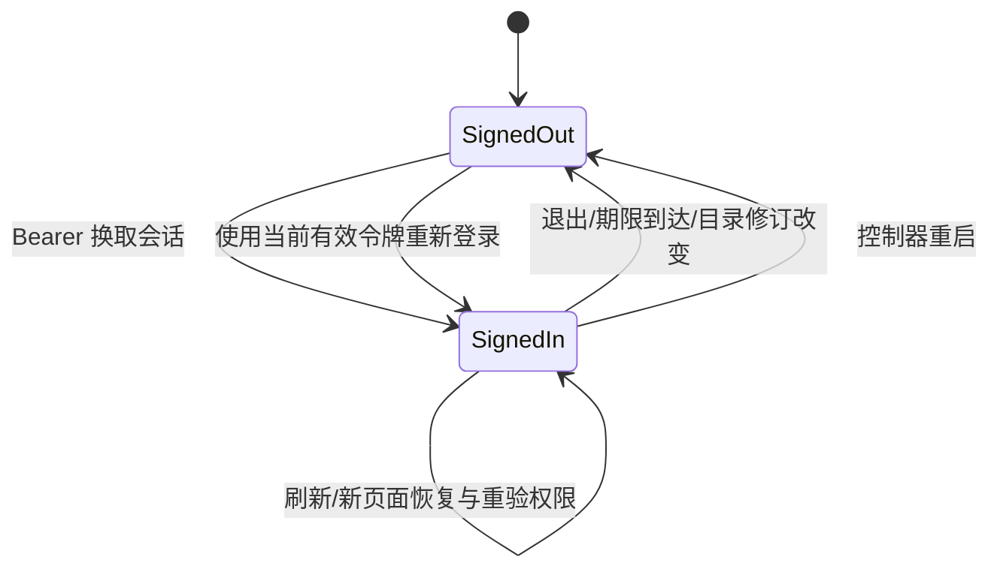

# SE-01/02/03/05：单控制节点会话设计

[English](/docs/en/sdd/design-sessions.html) · [需求](/docs/zh/sdd/spec.html) · [操作手册](/docs/zh/reference/browser-sessions.html)

本实现关闭浏览器刷新保持、单控制器会话生命周期、安全传输和现有 API 兼容四项。SE-04 共享会话与 CP 全局控制权威状态继续保留为未完成；MemoryStore 不是共享控制存储。控制器重启要求重新登录，不修改任务、账号或审计存储格式。

## 状态与接口

`BrowserSessions.Store` 定义 insert/find/touch/remove/close；当前实现为带最大容量、过期清理的内存映射。键为256位随机会话 ID 的 SHA256；值为身份快照、目录修订、CSRF 随机值、最后访问时间与绝对期限。不保留原始会话 ID 或 API 令牌。Cookie ID 和 CSRF 各使用32字节 SecureRandom、URL-safe Base64 无填充。

每次请求先恢复候选会话，再在 TaskService 当前账号目录下核验用户存在、可用且目录修订一致。任何目录修改严格撤销全部旧会话；任务提交继续经过已有 currentActor 版本校验。显式 Bearer 不回退 Cookie，双有效身份不一致拒绝；审计继续保存认证身份与结果，不保存认证材料。

以后共享后端必须实现原子有界创建、到期/触摸/撤销和强一致权限重验，同时与共享账号、审计及节点命令权威状态整合。仅把此接口换成某个 Map 或挂载共享文件夹不能关闭 SE-04。共享控制状态完整接口/迁移协议留到 CP-02 设计，不以空壳接口计为实现。

## HTTP 与页面合同

POST /api/session 仅接受 Bearer，GET /api/session 支持 Bearer 或 Cookie，POST /api/session/logout 只接受 Cookie。默认生产 Cookie 使用 __Host 前缀、Secure、HttpOnly、SameSite=Strict、Path=/、不设置 Domain；本地 HTTP 显式使用不同 Cookie 名。反向代理 publicOrigin 为精确外部 Origin，程序不信任 forwarded 头；Cookie 写请求必须同时通过 Origin/CSRF 检查。生产 TLS 由代理终止。

页面启动不读保存的令牌：先恢复服务器会话和权限，失效再显示登录框。语言是唯一持久 Web Storage 数据。每个 API 请求记录页面会话代次，迟到响应不能改写新会话；状态刷新锁也以代次隔离，旧刷新不会阻塞新登录。

登录、退出和自身令牌轮换后的重新认证经同一认证队列执行。退出立即清界面，再等待已发登录结束，取当前 CSRF 并撤销其 Cookie；这包括晚到登录响应。BroadcastChannel 只广播退出信号，接收方同样清理并排队撤销，不广播认证材料。服务端退出失败显示可重试的双语提示。自身令牌轮换成功后可以用刚确认保存的新令牌自动换取全新会话；旧会话仍失效。

## 验收边界

- 服务端8项真实 HTTP 合同测试：刷新恢复、Origin/CSRF 拒绝、角色约束、身份冲突、不回退、全目录撤销、轮换/停用/授权变化、自身轮换、关闭会话功能、控制器重启失效、期限/容量与配置校验。
- 同一候选 JAR 上 Java8/11/17/21/25 各运行上述8项；这是会话专项，不能替代全源/目标/JDK矩阵。
- TLS 代理 + 实际 CookieJar：HTTPS 发送 Cookie、HTTP 不发送 Secure 凭证、CSRF/Origin 拒绝、退出后旧 Cookie 不可重放、Bearer 兼容、状态中无明文会话/令牌。
- DOM 覆盖刷新/新页面、退出、跨标签页、迟到401/登录/刷新、服务端退出失败、自身令牌轮换；保留原编辑器/审计/校验/修复测试。
- 制品门禁、根构建及制品优先应用测试、Helm/原生清单一致性和更新后的 Docker 预览另行归档。

真实浏览器视觉/可访问性、真实 Kubernetes/CSI、多控制实例/共享会话、OIDC及人机空闲检测仍未验收。不会用本轮测试关闭这些历史欠项。
